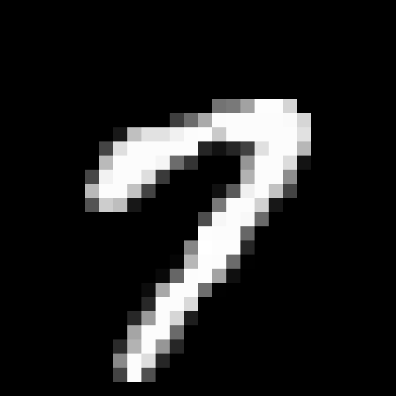

# MNIST Conditional Diffusion (Toy)

An educational, class-conditional score model built from scratch in PyTorch to generate handwritten MNIST digits. The model learns to denoise images using timestep and digit-label embeddings, with optional classifier-free guidance.

## Diffusion visualization



The animation illustrates forward noising from **t = 0 to t = 1 (red dots)** and reverse generation from **t = 1 to t = 0 (blue dots)**.

Place `digit7_diffusion_30s.gif` alongside this README so the animation displays on GitHub.

## Mathematical formulation

### Forward SDE — red dots (t = 0 → t = 1)

The general forward stochastic differential equation adds noise to the data:

$$
dx = f(x,t)\,dt + g(t)\,dw
$$

Here, $f(x,t)$ is the drift, $g(t)$ controls the noise magnitude, and $w$ is a Wiener process.

In `train.py`, noisy images are sampled directly rather than generated by numerically integrating the SDE:

$$
x_t = x_0 + \sigma_t\epsilon,
\qquad \sigma_t = t,
\qquad \epsilon \sim \mathcal{N}(0,I)
$$

This perturbation distribution corresponds to a drift-free forward SDE with $f(x,t)=0$ and $g(t)=\sqrt{2t}$, since the accumulated noise variance is $\sigma_t^2=t^2$.

### Score matching loss function

The network learns a time-dependent score using denoising score matching:

$$
\mathcal{L}
= \mathbb{E}\left[
\left\|\sigma_t\,s_\theta(x_t,t)+\epsilon\right\|_2^2
\right]
$$

Because this model is class-conditional, the implementation also supplies a digit label $y$, giving $s_\theta(x_t,t,y)$. The loss sums squared errors over image pixels and averages over the batch:

```python
std = t.view(-1, 1, 1, 1)
noise = torch.randn_like(images)
noisy_images = images + std * noise
predicted_score = model(noisy_images, t, labels)
loss = torch.mean(
    torch.sum((std * predicted_score + noise) ** 2, dim=[1, 2, 3])
)
```

During training, 20% of labels are replaced with the blank label `10` to learn the unconditional score used for classifier-free guidance.

### Reverse SDE — blue dots (t = 1 → t = 0)

The corresponding reverse-time SDE uses the learned score to remove noise:

$$
dx = \left[f(x,t)-g(t)^2\,s_\theta(x_t,t)\right]\,dt
+ g(t)\,d\bar{w}
$$

Time runs backward, so $dt$ is negative; $\bar{w}$ denotes a reverse-time Wiener process. For conditional generation, the score also depends on the requested digit label.

**Implementation note:** this equation describes the reverse-SDE framework. `generate.py` currently implements custom denoising updates, rather than a direct numerical solver of this reverse SDE. Its default deterministic sampler uses:

$$
\hat{x}_0 = x_t + t^2 s_\theta(x_t,t,y)
$$

$$
x_{t_{\mathrm{next}}}
= \hat{x}_0 + \frac{t_{\mathrm{next}}}{t}(x_t-\hat{x}_0)
$$

The CLI calls this sampler `ddim`; it is an additive-noise, DDIM-style update rather than a standard DDPM-based DDIM implementation. The alternative `euler` option is also a custom denoising routine.

## Quick usage

1. Train (example):

```bash
python train.py
```

This saves `mnist_cfg_model.pth` in the project root.

2. Generate a digit after training:

```bash
python generate.py --digit 7 --out gen7.png --steps 50
```

`generate.py` now requires `mnist_cfg_model.pth`. If the checkpoint is missing, it exits with a clear error instead of sampling from untrained weights.

## Requirements

- Python 3.8+
- torch
- torchvision

## Scope

This project is a minimal educational example and is not tuned for high-quality generation. The visualization illustrates the diffusion concept; sample quality depends on the trained checkpoint and sampling settings.
